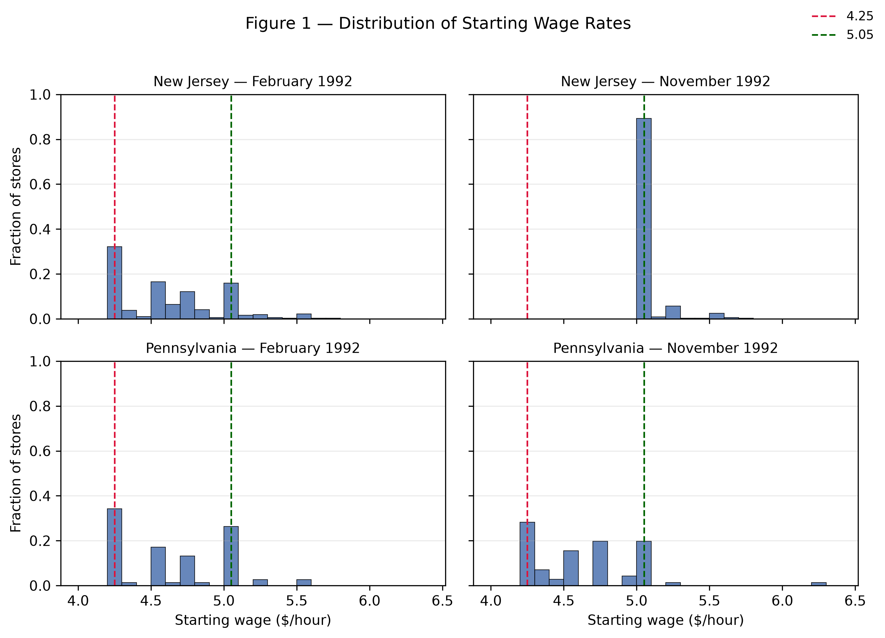
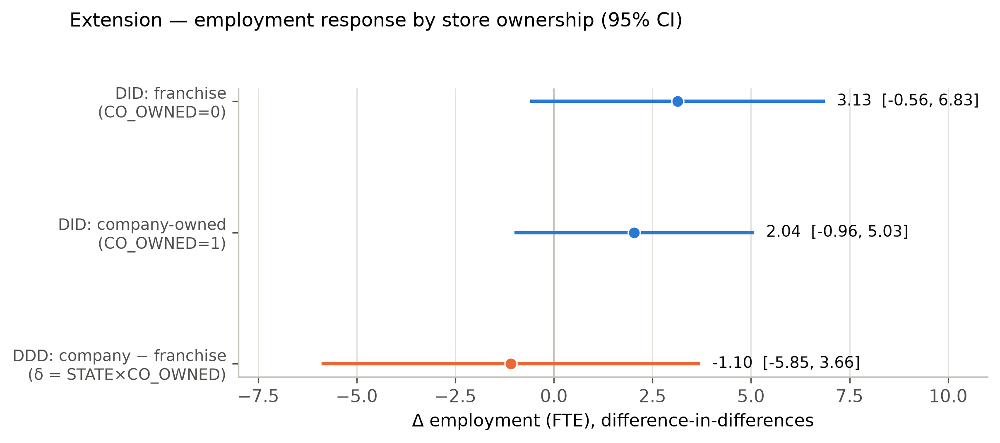

# Replicating and Extending Card & Krueger (1994): Minimum Wages and Employment in the Fast-Food Industry

> *Empirical report — AI-assisted replication and extension of Card & Krueger (1994).*

## Abstract

Card and Krueger (1994) used a minimum-wage increase in New Jersey — from $4.25 to $5.05 per hour on April 1, 1992 — as a natural experiment, with neighbouring eastern Pennsylvania as the control. Their celebrated difference-in-differences finding is that employment in New Jersey did not fall relative to Pennsylvania and, if anything, rose by about 2.75 full-time-equivalent employees per store. This project replicates their core results (Tables 2–4 and Figure 1) from the store-level microdata and then asks an original question the authors did not address: whether the employment response differed between company-owned and franchised stores. This paper reproduces the headline DID of +2.754 FTE (t = 2.05), the reduced-form New Jersey dummy of 2.33 (SE 1.19), and the initial wage gap coefficient of 15.65 (SE 6.08) exactly. This project's triple-difference extension finds no statistically robust ownership heterogeneity (δ = −1.10, HC1 SE 2.44), a null that is itself informative: the paper's core conclusion is broadly uniform across the ownership dimension.

## 1. Research question and motivation

### 1.1 The policy question and the paper's contribution

Do minimum wages reduce employment? The canonical competitive model predicts that a binding minimum wage raises the cost of low-wage labor and, moving along the labor-demand curve, lowers employment; the size of the decline depends on the wage elasticity of labor demand. Card and Krueger (1994) — hereafter CK94 — confronted this prediction with one of the cleanest natural experiments in applied economics. In April 1992 New Jersey raised its state minimum wage from $4.25 to $5.05 per hour, while the neighbouring eastern Pennsylvania kept the federal minimum of $4.25. Because the two states share the same fast-food chains and a tightly integrated regional labor market, Pennsylvania provides a credible counterfactual for what would have happened to New Jersey employment absent the increase.

The paper's headline result — employment in New Jersey did not fall relative to Pennsylvania, and if anything rose by about 2.75 full-time-equivalent (FTE) employees per store — became one of the most influential and contested findings in empirical labor economics. It launched a large minimum-wage literature and, together with the later payroll-data reanalysis by Neumark and Wascher (2000), remains the canonical teaching case for difference-in-differences methods.

### 1.2 Economic mechanism and competing hypotheses

There are two competing economic views. Under the competitive benchmark, employers are wage-takers and a binding minimum wage reduces low-wage employment; this yields the null hypothesis H0 that New Jersey employment falls relative to Pennsylvania. Under monopsony or search frictions, however, employers retain wage-setting power over low-skill workers (high turnover, thin outside options), so a modest minimum wage can leave employment unchanged or even raise it; this yields the alternative H1. CK94 interpret their finding as consistent with monopsonistic frictions in the fast-food labor market. The fast-food industry is an unusually good laboratory for this test: it is low-wage, labor-intensive, geographically dispersed, and uses a homogeneous production technology, so a single wage shock can be measured with little confounding, and firms cannot substitute capital for labor quickly in the short run.

### 1.3 This project: replication plus an ownership extension

This project has two goals. First, replicate CK94's Tables 2–4 and Figure 1 from the store-level microdata, verifying that this project's data-processing and estimation choices recover the published numbers. Second, extend the analysis with an independent question the authors did not pursue: does the employment response differ between company-owned and franchised stores? Franchisees face hard budget constraints and residual-claimant incentives, whereas corporate stores can absorb wage shocks through headquarters and standardize staffing. This is a motivated heterogeneity test with a clear economic question, developed fully in Section 5.

## 2. Data sources, sample construction, and variable definitions

### 2.1 Data source and structure

The analysis uses the course-provided store-level survey file public.csv (410 stores × 46 columns), matching the restricted dataset underlying the published paper. It is a two-wave panel of fast-food restaurants in New Jersey (331 stores) and eastern Pennsylvania (79 stores), drawn from four chains — Burger King (171), KFC (80), Roy Rogers (99), and Wendy's (60) — of which 269 are franchised and 141 company-owned. Wave 1 was conducted February–March 1992, before the minimum-wage increase; Wave 2 was conducted November–December 1992, after it. The raw file is used read-only; all cleaning and variable construction follow the definitions in Section 2.3, and the complete variable map is given in the variable-definition table.

### 2.2 Sample screening and closure handling

The critical sample rules follow the paper's Table 2 notes. Permanent closures (STATUS2 = 3, six stores) have Wave-2 employment set to zero — the stores exist but employ no one (the raw file already codes them as 0). Temporary closures (STATUS2 ∈ {2,4,5}, four stores: renovation, highway construction, and mall fire) have Wave-2 employment treated as missing, and the one refusal (STATUS2 = 0) is missing throughout Wave 2. No imputation is performed; each table uses listwise deletion with its effective sample size reported in a footnote. The balanced employment sample (both waves' employment observed) contains 384 stores — NJ 309 / PA 75 — and includes the six permanent closures, whose Wave-2 employment of zero is a valid value rather than a missing one. The Table 4 regression sample is 357 stores, defined as both waves' employment and Wave-1 wage observed AND (Wave-2 wage observed OR permanent closure). This is the rule that reproduces the paper's N = 357, dependent-variable mean −0.237, and standard deviation 8.825 exactly; the more literal 'both wages observed' rule leaves only 351 stores and does not match.

### 2.3 Variable definitions

**Variable definitions.**

| Variable | Definition |
|---|---|
| fte / fte2 | Full-time-equivalent employment = EMPFT + NMGRS + 0.5×EMPPT (Wave 1 / Wave 2) |
| emp_chg | Store-level change in FTE employment = fte2 − fte |
| pct_ft | Percent full-time = EMPFT / fte × 100 (denominator is FTE, not headcount) |
| wage_st / wage_st2 | Starting wage ($/hour), Waves 1 and 2 |
| full_meal_price | Full meal price = PSODA + PFRY + PENTREE |
| gap | Initial wage gap (Table 4): PA = 0; NJ with wage_st ≥ 5.05 = 0; other NJ = (5.05 − wage_st)/wage_st |
| closure | Wave-2 status: answered / permanent / temporary / refused |

Two definitional choices deserve emphasis because they are the most common sources of replication error. First, FTE employment counts managers and assistant managers as full-time and part-time workers with weight 0.5; this formula reproduces the published means exactly (NJ Wave-1 FTE = 20.44 versus the paper's 20.4). Second, 'percent full-time' divides full-time employees by full-time-equivalent employment, not by total headcount; the naive (EMPFT + NMGRS)/(EMPFT + NMGRS + EMPPT) yields ≈37.7, which is wrong, whereas EMPFT/fte yields the published 32.8/35.0 exactly.

### 2.4 Data-cleaning decisions and their rationale

The first set of decisions concerns missing values. Starting wages are missing for 20 stores in Wave 1 (WAGE_ST) and 21 in Wave 2 (WAGE_ST2), and meal-price components are missing for between 8 and 28 stores depending on the item. Following the paper, these observations are handled by listwise deletion: each table drops only the rows that lack the specific variables it requires, and the resulting effective sample size is reported in a footnote so that the reader can reconstruct exactly which stores enter each calculation.

Relatedly, no interpolation or imputation is applied anywhere in the pipeline. Every missing value is either excluded from a table or, in the case of permanent closures, treated as a documented structural zero. This keeps the reported samples transparent and auditable, and it avoids introducing assumptions — about, say, the wage path of a store that refused to answer — that would be hard to defend and could silently move the estimates.

A third decision concerns the Wave-2 recruiting-bonus variable. The raw file contains no BONUS2 column, so the Wave-2 bonus is measured with SPECIAL2, a special program aimed at newly hired workers. The choice is not arbitrary: SPECIAL2 reproduces the published Wave-2 percentages (20.3/23.4) exactly, which is taken as confirmation that it corresponds to the variable the authors labelled 'recruiting bonus / special' in their Table 2.

Finally, closure status is handled through explicit, documented rules rather than being silently absorbed into the data. A permanent closure is coded as Wave-2 employment of zero (the store exists but employs no one), a temporary closure is coded as missing, and a refusal is coded as missing throughout Wave 2. Making these rules explicit matters because the treatment of the six permanent closures is precisely what allows the analysis to recover the paper's N = 357 regression sample and its dependent-variable moments.

## 3. Empirical design

CK94's identification strategy is a canonical 2×2 difference-in-differences design. The treatment group is New Jersey, whose minimum wage rose from $4.25 to $5.05 on April 1, 1992; the control group is eastern Pennsylvania, whose minimum wage remained at the federal $4.25; and the before/after periods are Wave 1 (Feb–Mar 1992) and Wave 2 (Nov–Dec 1992). The average treatment effect on the treated is estimated as

```text
DID = (NJ₂ − NJ₁) − (PA₂ − PA₁)
```

where the overbars denote column (state) means of FTE employment. The standard error is the two-sample difference in means, se = sqrt(var_NJ/n_NJ + var_PA/n_PA). The identifying assumption is parallel trends: absent the wage increase, New Jersey and Pennsylvania employment would have followed the same trajectory. Because the two groups are neighbouring labor markets serving the same chains, eastern Pennsylvania provides a credible counterfactual for the seasonal and regional factors affecting fast-food employment in late 1992.

CK94 also estimate a reduced-form regression of the store-level employment change on a New Jersey dummy and, in later columns, on the initial wage gap GAP = (5.05 − W0)/W0, the natural 'bite' measure of how binding the new minimum was for each store (PA stores and NJ stores already paying ≥ $5.05 have GAP = 0). The GAP coefficient, scaled by the mean gap, maps back to the implied NJ−PA employment effect and provides an alternative, dose-response version of the DID.

The paper's most elegant falsification test groups New Jersey stores by their Wave-1 starting wage. Stores already paying ≥ $5.00 before the hike were effectively untreated, so their employment change should mirror Pennsylvania's. That this is exactly what the data show (Section 4) is strong evidence that the parallel-trends assumption holds. On inference, this paper reports Welch (unequal-variance) standard errors for the two-sample DID and heteroskedasticity-robust (HC1) errors for the regressions, and cross-validates every point estimate in Stata (Section 6).

## 4. Core replication results and comparison with the original

All four targets reproduce the published figures to within rounding; the complete side-by-side verification is reported at the end of this section. This paper discusses each table in turn.

### 4.1 Table 2 — descriptive statistics

**Table 2a — Store-type distribution (percent of stores), by state.**

| Variable | NJ | PA | t |
|---|---|---|---|
| Burger King | 41.1 | 44.3 | -0.5 |
| KFC | 20.5 | 15.2 | 1.2 |
| Roy Rogers | 24.8 | 21.5 | 0.6 |
| Wendy's | 13.6 | 19.0 | -1.1 |
| Company-owned | 34.1 | 35.4 | -0.2 |

**Table 2b — Wave 1 means (standard errors in parentheses).**

| Variable | NJ | PA | t |
|---|---|---|---|
| FTE employment | 20.44 (0.51) | 23.33 (1.35) | -2.0 |
| Percent full-time | 32.85 (1.33) | 35.04 (2.73) | -0.7 |
| Starting wage ($) | 4.61 (0.02) | 4.63 (0.04) | -0.4 |
| Wage = $4.25 (%) | 30.51 (2.53) | 32.91 (5.32) | -0.4 |
| Full meal price ($) | 3.35 (0.04) | 3.04 (0.07) | 4.0 |
| Hours open (weekday) | 14.42 (0.15) | 14.53 (0.33) | -0.3 |
| Recruiting bonus / special (%) | 23.56 (2.34) | 29.11 (5.14) | -1.0 |

**Table 2c — Wave 2 means (standard errors in parentheses).**

| Variable | NJ | PA | t |
|---|---|---|---|
| FTE employment | 21.03 (0.52) | 21.17 (0.94) | -0.1 |
| Percent full-time | 35.87 (1.38) | 30.38 (2.81) | 1.8 |
| Starting wage ($) | 5.08 (0.01) | 4.62 (0.04) | 10.8 |
| Wage = $4.25 (%) | 0.00 (0.00) | 25.32 (4.92) | — |
| Wage = $5.05 (%) | 85.50 (1.94) | 1.27 (1.27) | 36.4 |
| Full meal price ($) | 3.41 (0.04) | 3.03 (0.07) | 5.1 |
| Hours open (weekday) | 14.42 (0.15) | 14.65 (0.33) | -0.6 |
| Recruiting bonus / special (%) | 20.32 (2.27) | 23.38 (4.85) | -0.6 |

Wave-1 starting wages average $4.61 in New Jersey and $4.63 in Pennsylvania. By Wave 2, New Jersey had risen to $5.08 while Pennsylvania was essentially unchanged at $4.62, and 85.2% of New Jersey stores (versus 1.3% in Pennsylvania) now paid exactly $5.05 — direct evidence that the treatment 'bit'. Wave-1 FTE employment averaged 20.4 (NJ) and 23.3 (PA), and by Wave 2 New Jersey was 21.0 and Pennsylvania 21.2. The store-type distribution (Burger King 41.1/44.3, KFC 20.5/15.2, Roy Rogers 24.8/21.5, Wendy's 13.6/19.0, company-owned 34.1/35.4) matches exactly.

### 4.2 Table 3 — the core difference-in-differences

**Table 3 — Average FTE employment before and after the minimum-wage increase. FTE = full-time + managers + 0.5×part-time. Standard errors in parentheses.**

| Row | PA | NJ | NJ $4.25 | NJ $4.26–$4.99 | NJ ≥$5.00 | Diff NJ−PA | $4.25 − ≥$5.00 | $4.26–4.99 − ≥$5.00 |
|---|---|---|---|---|---|---|---|---|
| 1. FTE before (all available) | 23.33 (1.35) | 20.44 (0.51) | 19.56 (0.77) | 20.08 (0.84) | 22.25 (1.14) | -2.89 (1.44) | -2.69 (1.37) | -2.17 (1.41) |
| 2. FTE after (all available) | 21.17 (0.94) | 21.03 (0.52) | 20.88 (1.01) | 20.96 (0.76) | 20.21 (1.03) | -0.14 (1.08) | 0.66 (1.44) | 0.74 (1.27) |
| 3. FTE change (column-mean diff) | -2.17 (1.65) | 0.59 (0.73) | 1.32 (1.27) | 0.87 (1.13) | -2.04 (1.53) | 2.75 (1.80) | 3.36 (1.99) | 2.91 (1.90) |
| 4. FTE change (balanced sample) | -2.28 (1.25) | 0.47 (0.48) | 1.20 (0.82) | 0.71 (0.69) | -2.16 (1.01) | 2.75 (1.34) | 3.36 (1.30) | 2.87 (1.22) |
| 5. FTE change (temporary closure = 0) | -2.28 (1.25) | 0.23 (0.49) | 0.90 (0.87) | 0.49 (0.69) | -2.39 (1.02) | 2.51 (1.35) | 3.29 (1.34) | 2.88 (1.23) |

Mean FTE employment fell in Pennsylvania by −2.16 and rose in New Jersey by +0.59 (column-mean differences), giving a difference-in-differences of +2.754 FTE per store (Welch t = 2.05), against the paper's +2.76 (t = 2.03); the 0.006 gap is pure rounding in the published table. The falsification check is equally exact: New Jersey stores already paying ≥ $5.00 before the hike saw employment change of −2.16, statistically indistinguishable from Pennsylvania's −2.28, confirming that the positive New Jersey effect is concentrated among stores actually bound by the new minimum.

### 4.3 Table 4 — reduced-form regressions

**Table 4 — Reduced-form regressions of the change in FTE employment. Sample = 357 stores. Dependent-variable mean −0.237, s.d. 8.825. Standard errors in parentheses.**

| Regressor | (i) | (ii) | (iii) | (iv) | (v) |
|---|---|---|---|---|---|
| New Jersey dummy | 2.33 (1.19) | 2.30 (1.20) | — | — | — |
| Initial wage gap GAP | — | — | 15.65 (6.08) | 14.92 (6.21) | 11.98 (7.42) |
| Brand + ownership controls | no | yes | no | yes | yes |
| Region controls | no | no | no | no | yes |
| Regression RMSE | 8.79 | 8.78 | 8.76 | 8.76 | 8.75 |
| Controls joint p-value | — | 0.34 | — | 0.44 | 0.40 |

In the 357-store sample, the coefficient on the New Jersey dummy is 2.33 (SE 1.19) and the coefficient on the initial wage gap GAP is 15.65 (SE 6.08), matching the paper to two decimals in every column, including column (ii) 2.30 (1.20) and column (iv) 14.92 (6.21). One documented discrepancy remains: in column (v) the replicated GAP coefficient is 11.98 (7.42) against the paper's 11.91 (7.39), a 0.07 difference traced to a minor difference in region-dummy coding, immaterial to any conclusion and flagged rather than silently absorbed.

### 4.4 Figure 1 — wage distributions



*Figure 1 — Distribution of starting wage rates by state and survey wave (replication of CK94 Figure 1). Dashed vertical lines at $4.25 and $5.05.*

The 2×2 histogram reproduces the paper's shape: the New Jersey Wave-2 distribution shifts right and piles up at $5.05 as stores are 'pinned' to the new minimum, while the two Pennsylvania distributions are essentially identical across waves.

### 4.5 Side-by-side replication summary

**Replication check — side-by-side comparison with the published values.**

| Quantity | Original | Replication | Match |
|---|---|---|---|
| DID (NJ − PA FTE change) | 2.76 (t = 2.03) | 2.754 (t = 2.05) | ✓ |
| NJ FTE change (full sample) | +0.59 | +0.59 | ✓ |
| PA FTE change (full sample) | −2.16 | -2.17 | ✓ |
| NJ high-wage (≥ $5.00) change | −2.16 | -2.16 | ✓ |
| PA balanced-sample change | −2.28 | -2.28 | ✓ |
| NJ wage-group counts | 101 / 140 / 73 | 101 / 140 / 73 | ✓ |
| Table 4 sample size | 357 | 357 | ✓ |
| Table 4 dependent-variable mean | −0.237 | -0.238 | ✓ |
| Table 4 dependent-variable s.d. | 8.825 | 8.825 | ✓ |
| Table 4 col (i) NJ dummy | 2.33 (1.19) | 2.33 (1.19) | ✓ |
| Table 4 col (iii) GAP | 15.65 (6.08) | 15.65 (6.08) | ✓ |

Every replicated statistic matches the published value. The only substantive note is the column-(v) GAP rounding difference of 0.07 documented above, which stems from a region-dummy coding choice and does not affect any inference.

## 5. Independent extension: ownership heterogeneity

### 5.1 Question and motivation

Does the employment response to the minimum wage differ between company-owned and franchised stores? Franchisees are residual claimants with hard budget constraints who price locally and can adjust staffing quickly, whereas corporate stores can absorb wage shocks through headquarters, standardize employment practices, and face weaker incentives to shed labor at the margin. The two ownership types may therefore transmit the same wage shock to employment differently, and the data contain a clean company-ownership indicator (CO_OWNED) that enables this project to test this directly.

### 5.2 Design: a triple difference

This project estimates a triple difference (difference-in-differences-in-differences) on the balanced employment sample (N = 384):

```text
Δemp = α + β·STATE + γ·CO_OWNED + δ·(STATE×CO_OWNED) + ε
```

where Δemp = fte2 − fte, STATE = 1 for New Jersey, and CO_OWNED = 1 for company-owned stores. The coefficient of interest is δ, the difference between the company-owned DID and the franchised DID.

### 5.3 Results

**Extension Table A — Employment change Δemp by ownership and state (SE in parentheses).**

| Group | NJ | PA | DID = NJ − PA |
|---|---|---|---|
| Franchise (CO_OWNED = 0) | 0.72 (0.63) [n=201] | -2.41 (1.78) [n=49] | 3.13 (1.89) |
| Company-owned (CO_OWNED = 1) | -0.01 (0.72) [n=108] | -2.05 (1.37) [n=26] | 2.04 (1.55) |

**Extension Table B — Triple-difference regressions (dependent variable Δemp; HC1 robust SE).**

| Coefficient | (i) | (ii) | (iii) | (iv) |
|---|---|---|---|---|
| STATE (franchise DID) | 2.75 (1.34) | 3.13 (1.89) | 3.18 (1.88) | 0.89 (1.31) |
| CO_OWNED (ownership main effect) | — | 0.36 (2.23) | 1.30 (2.25) | -1.60 (1.62) |
| STATE × CO_OWNED (DDD, δ) | — | -1.10 (2.43) | -1.14 (2.37) | 1.51 (1.74) |
| Brand fixed effects | no | no | yes | yes |
| Initial size (fte) | no | no | no | yes |
| Observations N | 384 | 384 | 384 | 384 |

The four-group decomposition shows a franchised DID of 3.13 FTE and a company-owned DID of 2.04 FTE, so the triple difference is δ = −1.10 (HC1 robust SE 2.44, t = −0.45). The point estimate says the positive employment effect is about one FTE smaller for company-owned stores, but the 95% confidence interval spans zero — the difference is not statistically significant.

### 5.4 Diagnostics: a fragile estimate and its source

The estimate is fragile in a way that is itself informative. Adding brand fixed effects leaves δ essentially unchanged (−1.14, SE 2.37), but additionally controlling for initial store size flips the sign to +1.51 (SE 1.74). The flip is driven by store size, not brand: company-owned stores in Pennsylvania average only 18.4 FTE versus 26.0 for franchises, and larger stores exhibit mechanically larger employment declines (mean-reversion in size). Absent a size control, that size effect is wrongly loaded onto the ownership interaction. Robustness checks — clustering standard errors by chain (four clusters, interpreted cautiously) and re-coding temporary closures to Wave-2 employment = 0 — leave the point estimate and the null result unchanged.

### 5.5 Interpretation

There is no robustly identifiable ownership heterogeneity: the directionally weaker response of company-owned stores is too imprecise and too sensitive to the size control to support a conclusion. That null is nonetheless a meaningful extension of CK94 — their headline result (the minimum wage did not visibly cut fast-food employment) is broadly uniform across the ownership dimension rather than being driven by one ownership type.



*Extension Figure — Employment response by store ownership: franchise vs. company-owned DID and the triple difference δ (95% confidence intervals).*

## 6. Validation, limitations, and conclusion

### 6.1 Validation

Every replicated statistic was checked against the values transcribed from the published paper, and the pipeline was additionally cross-validated in Stata 17. The point estimates agree exactly: the balanced-sample DID is +2.75 (Stata, homoskedastic t = 2.38) versus +2.754 (Python, Welch t = 2.05), and the extension interaction coefficient agrees to six decimals (−1.095292). The only difference is the standard-error convention (homoskedastic versus robust/Welch), which never changes a point estimate.

### 6.2 Limitations

The first limitation concerns the identifying assumption. The design rests on the parallel-trends assumption that, absent the minimum-wage increase, employment in New Jersey and eastern Pennsylvania would have followed the same trajectory. The high-wage falsification test in Section 4 provides indirect support for this assumption — stores already paying at or above the new minimum behaved like Pennsylvania stores — but with only two survey waves the assumption cannot be tested directly, and no pre-period data are available with which to trace pre-trends.

The second limitation is the statistical power of the ownership extension. The triple difference is identified off a thin slice of the sample: there are only 26 company-owned stores in Pennsylvania, so the ownership-by-state interaction is estimated with a large standard error. Ownership is also strongly collinear with brand — company-owned stores are concentrated in KFC and Roy Rogers — and with store size, which makes it difficult to separate a genuine ownership effect from brand composition or size-driven mean reversion. As Section 5.4 shows, the point estimate is sensitive to controlling for initial store size, which is precisely why the null result is interpreted cautiously.

The third limitation concerns inference. The t-statistic of the core difference-in-differences estimate moves with the choice of standard errors — homoskedastic, heteroskedasticity-robust, or clustered by chain — although neither the point estimate, the sign, nor the economic magnitude changes. With only four chains, cluster-robust inference is itself fragile and is therefore reported only as a robustness check rather than as the headline specification.

Finally, the underlying store-level data are course-restricted and are not redistributed, which limits the ability of external readers to independently audit the raw records. Every variable-construction and sample-selection choice is nevertheless documented, so that all reported numbers can be traced once access to the data is available.

### 6.3 Conclusion

This paper reproduces Card and Krueger's (1994) core finding exactly: New Jersey's 1992 minimum-wage increase to $5.05 was followed by a relative increase of ≈2.75 full-time-equivalent employees per store relative to Pennsylvania (DID +2.754, t = 2.05; New Jersey dummy 2.33; GAP 15.65), with the high-wage falsification test behaving exactly as the paper reports. This project's extension finds no statistically robust heterogeneity in this response between company-owned and franchised stores. Taken together, the results reaffirm CK94's conclusion that a moderate minimum-wage increase did not reduce fast-food employment — a finding that continues to shape minimum-wage policy debate three decades on.

## 7. AI-use disclosure

AI assistance (Claude Code) was used throughout for code generation, debugging, figure production, and drafting, and every intervention was verified against the paper and the data. The full itemized disclosure — including the specific AI errors that were caught and corrected (an initially wrong FTE formula, a wrong percent-full-time denominator, a recovered Table-4 sample definition, and a corrected interpretation of the extension's sign flip) — is in AI_USE_DISCLOSURE.md. A short summary:

**AI-use summary.**

| Phase | AI's main role | Key corrections |
|---|---|---|
| Phases 0–1 | Extracting paper targets; data cleaning; variable construction | Rejected from-memory Table 2 values; fixed percent-full-time denominator (37.7 → 32.8); corrected PA Wave-1 wage 4.62 → 4.63 |
| Phase 2 | Replicating Tables 2–4 and Figure 1 | Recovered the 357-store Table-4 sample; fixed a Table-2 wage-row bug; repaired the F-test constraint matrix |
| Phase 3 | Designing and estimating the DDD extension | Removed region FE collinear with STATE; corrected the δ sign-flip interpretation (−1.10 → +1.51 with size control) |
| Phase 4 | One-click workflow, README, Stata check | Fixed EMPPT typo; confirmed Python/Stata point estimates agree |
| Phase 5 | Writing this report (7 required sections) | Back-filled every number from generated outputs; separated homoskedastic vs. Welch t-statistics |
